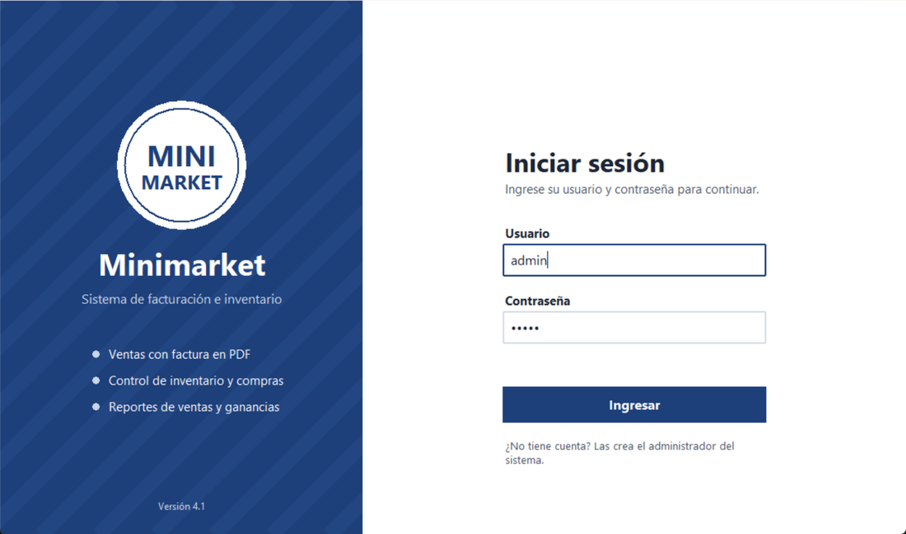
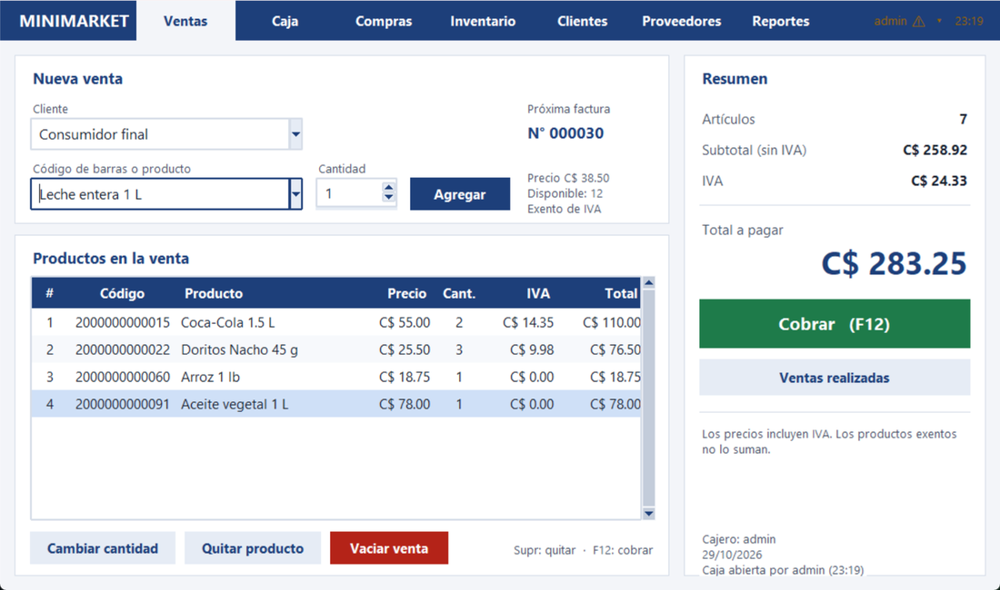
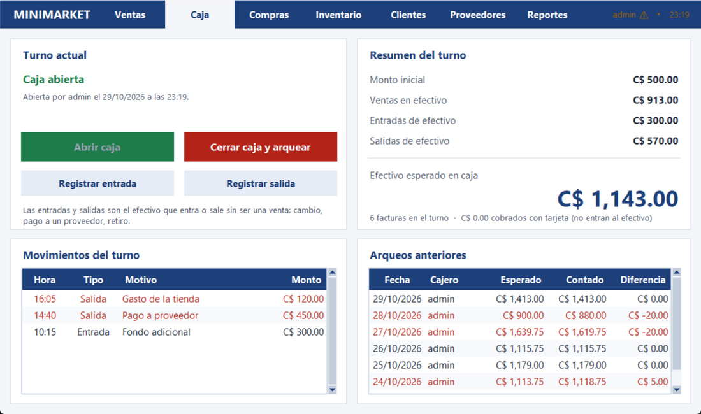
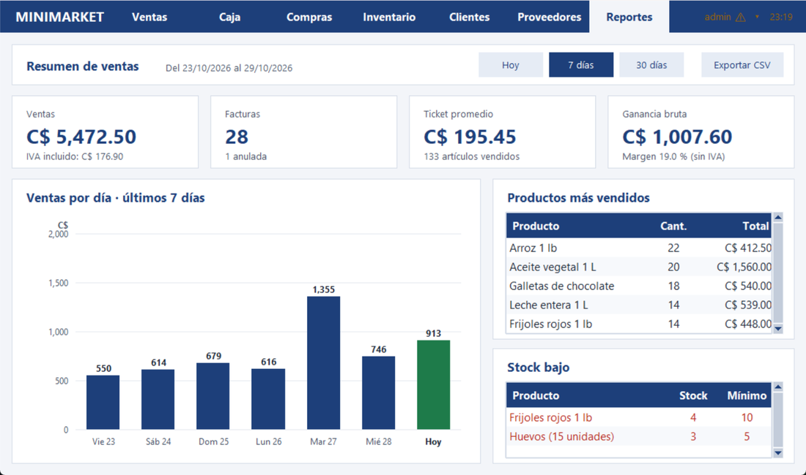
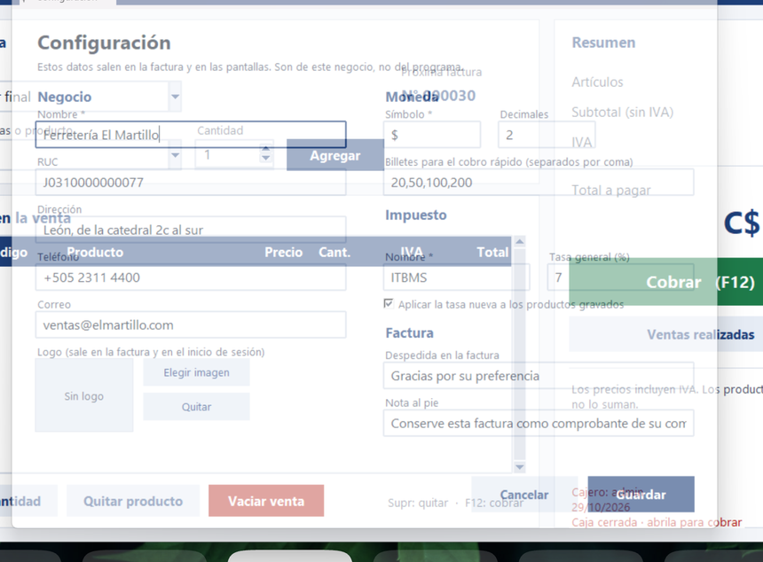
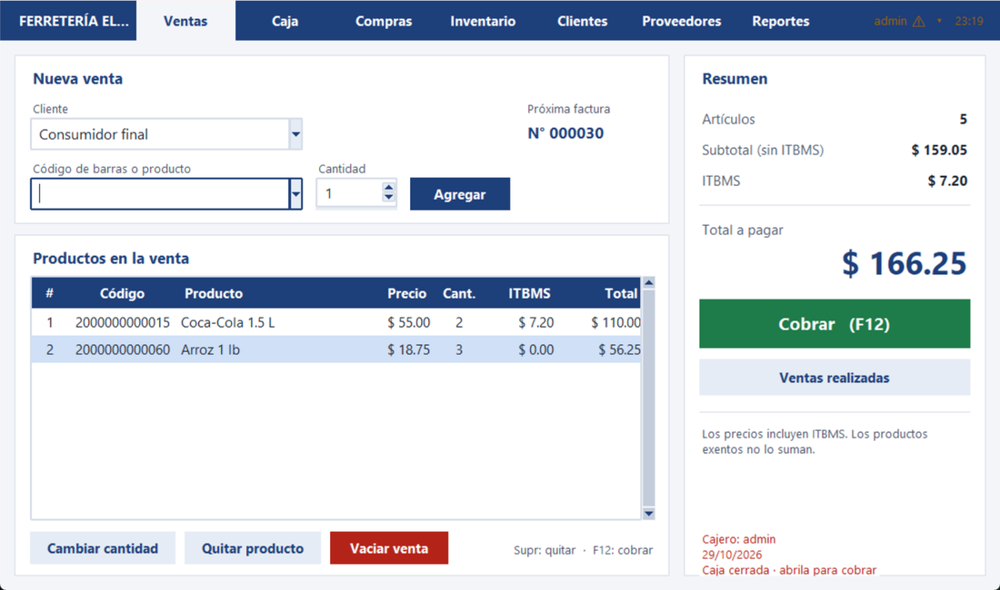

# Minimarket: sistema de facturación e inventario en Python

Sistema de punto de venta (POS) hecho con Python, Tkinter y SQLite. Registra ventas con
código de barras e impuesto, genera facturas en PDF, controla el inventario y las compras a
proveedores, maneja el turno de caja con su arqueo y muestra reportes de ventas y ganancias.
Tiene dos roles de usuario.

**Se instala en cualquier negocio sin tocar el código**: el nombre, el logo, la moneda, el
impuesto y los textos de la factura se configuran desde el propio programa.

| | |
|---|---|
|  |  |
|  |  |

## Funciones

- **Inicio de sesión y roles.** Contraseñas guardadas con hash (PBKDF2). Cada usuario es
  **cajero** o **administrador**, y el sistema le muestra solo lo que le toca. **No hay
  registro público**: las cuentas las crea un administrador.
- **Ventas.** El producto se agrega escribiendo o escaneando su **código de barras**, o
  buscándolo por nombre. El carrito no deja vender más de lo que hay en stock. Muestra
  subtotal, **IVA 15 %** (los productos de la canasta básica son exentos) y total.
- **Cobro.** Efectivo o tarjeta, botones de billetes y cambio calculado mientras se escribe.
  La venta se guarda en una sola transacción y genera la **factura en PDF**.
- **Caja.** El turno se abre con el dinero inicial y se cierra contando el efectivo: el
  sistema calcula lo que debería haber y muestra el **faltante o sobrante**. Registra las
  entradas y salidas de efectivo que no son ventas. Sin caja abierta no se puede cobrar.
- **Ventas realizadas.** Historial por factura con filtros (número, cliente, período y
  estado), reimpresión y **anulación** de facturas: la factura no se borra, queda anulada
  y el stock vuelve al inventario.
- **Compras.** Entrada de mercadería por proveedor: suma el stock y actualiza el costo. Si
  se paga con el efectivo de la caja, queda registrada como salida del turno.
- **Inventario.** Tarjetas con foto y estado del stock (normal, bajo, agotado, inactivo),
  búsqueda por nombre o código, filtros, detalle con margen de ganancia, formulario para
  crear o editar productos (con generador de códigos internos EAN-13) y exportación a CSV.
- **Clientes y proveedores.** Registro y edición con validación de cédula nicaragüense,
  RUC y correo. Se pueden **dar de baja** sin borrarlos: dejan de aparecer al vender o
  comprar, pero el historial se conserva. Las ventas de mostrador usan «Consumidor final».
- **Reportes.** Ventas, facturas, ticket promedio y ganancia bruta del período; gráfico de
  ventas por día; productos más vendidos; stock bajo; exportación a CSV.
- **Usuarios.** El administrador crea cuentas, cambia roles, desactiva usuarios y
  restablece contraseñas. Cualquiera puede cambiar la suya desde «Mi cuenta».
- **Configuración.** Nombre y datos del negocio, logo, símbolo y decimales de la moneda,
  denominaciones del cobro rápido, nombre y tasa del impuesto y los textos de la factura.
  Todo se guarda en la base de datos, no en el código.

### Qué puede hacer cada rol

| | Cajero | Administrador |
|---|:---:|:---:|
| Vender y cobrar | ✓ | ✓ |
| Abrir y cerrar su caja | ✓ | ✓ |
| Ver el historial de ventas | ✓ | ✓ |
| Consultar inventario y clientes | ✓ | ✓ |
| Anular facturas | | ✓ |
| Crear y editar productos | | ✓ |
| Compras y proveedores | | ✓ |
| Reportes (ve costos y ganancias) | | ✓ |
| Usuarios y arqueos de todos | | ✓ |
| Configuración del negocio | | ✓ |

## Tecnologías

Python 3 · Tkinter / ttk · SQLite3 · Pillow (imágenes) · ReportLab (facturas PDF)

## Cómo ejecutarlo

Requiere Python 3 en Windows.

```powershell
git clone https://github.com/DevLearnsAl/Sistema-POS-Tkinter.git
cd Sistema-POS-Tkinter
py -m pip install -r requirements.txt
py index.py
```

Datos de acceso:

- Usuario: `admin` · Contraseña: `admin` (el sistema avisa mientras siga siendo esa)

Las demás cuentas se crean desde **Usuarios**, en el menú de arriba a la derecha. No hay
pantalla de registro: en un punto de venta, quién puede cobrar no lo decide cada quien.

La primera vez, el programa crea `database.db` con datos de ejemplo: 11 productos, 4
clientes, 3 proveedores, una semana de ventas y sus 7 arqueos de caja. **Para vender hay
que abrir la caja primero**, en el módulo Caja. Para empezar de cero, borrá `database.db`.

Para adaptarlo a un negocio, entrá con el administrador y abrí **Configuración** desde el
menú de usuario, arriba a la derecha.

Atajos: **F1** a **F7** cambian de módulo, **Enter** agrega el producto, **F12** cobra y
**Supr** quita la línea seleccionada.

## Pruebas

```powershell
py tests/prueba_completa.py
```

Maneja la interfaz como un usuario sobre una copia temporal del proyecto (no toca tu
base de datos) y comprueba 175 casos: migraciones, login y roles, permisos del cajero,
creación de usuarios, apertura y cierre de caja con su arqueo, ventas con código de barras e
impuesto, cobro en efectivo y tarjeta, stock insuficiente, anulación, inventario, compras
pagadas de la caja, clientes, proveedores, reportes, configuración del negocio y registro de
errores.

## Cómo funciona

Flujo de una venta:

1. Abrir la caja con el efectivo con el que arranca el turno.
2. Escanear o escribir el código de barras (o parte del nombre) y pulsar **Enter**.
3. Repetir con cada producto. El resumen muestra subtotal, IVA y total.
4. Pulsar **Cobrar (F12)**, elegir efectivo o tarjeta e ingresar el monto recibido.
5. La venta se guarda en una transacción `BEGIN IMMEDIATE`: se comprueba que la caja siga
   abierta, se vuelve a comprobar el stock, se asigna el número de factura y se descuenta
   el inventario. Si algo falla, no se guarda nada.
6. La factura se guarda en `facturas/Factura_<número>.pdf`.

Al cerrar el turno, el arqueo compara lo contado con lo esperado:

```
esperado   = monto inicial + ventas en efectivo + entradas - salidas
diferencia = contado - esperado        (negativo = falta, positivo = sobra)
```

Las facturas anuladas no suman, porque ese dinero se devolvió.

### Estructura del proyecto

| Archivo | Qué hace |
|---|---|
| `index.py` | Punto de entrada: prepara la base de datos y abre la aplicación |
| `manager.py` | Ventana principal; cambia entre el inicio de sesión y el sistema; guarda el rol |
| `container.py` | Barra superior con los módulos según el rol, atajos, usuario y hora |
| `login.py` | Inicio de sesión |
| `ventas.py` | Carrito, cobro, venta registrada, historial y anulación |
| `caja.py` | Turnos de caja, movimientos de efectivo y cierre con arqueo |
| `factura.py` | Factura en PDF (varias páginas y sello de anulada) |
| `compras.py` | Entrada de mercadería |
| `inventario.py` | Tarjetas de productos, detalle, formulario y exportación |
| `catalogo.py` | Clientes y Proveedores (misma pantalla, distinta configuración) |
| `reportes.py` | Indicadores, gráfico, más vendidos, stock bajo y CSV |
| `usuarios.py` | Mi cuenta y administración de usuarios |
| `configuracion.py` | Pantalla de configuración del negocio |
| `ajustes.py` | Lee y guarda esa configuración; moneda e impuesto |
| `estilos.py` | Colores, fuentes y widgets comunes |
| `db.py` | Conexión a la base: cierra siempre y deshace si hay error |
| `seguridad.py` | Hash de contraseñas |
| `registro.py` | Registro de errores en `logs/minimarket.log` |
| `config.py` | Versión, carpetas y permisos de cada rol |
| `schema.sql`, `crear_bd.py` | Esquema, datos de ejemplo, respaldos y migración |
| `utilidades.py` | Cálculo de IVA, códigos EAN-13 y búsqueda de productos |
| `tests/` | Prueba completa del sistema |
| `fotos/`, `imagenes/` | Fotos de productos e ícono de la aplicación |

### Un solo programa para varios negocios

Lo que cambia de un cliente a otro no está en el código sino en la tabla `configuracion`,
y se edita desde la pantalla de Configuración. Así no hace falta una copia del programa por
cliente: es el mismo, con otra configuración.

| | |
|---|---|
|  |  |

A la derecha, el mismo programa de las capturas de arriba configurado como otro negocio:
otro nombre, otra moneda y otro impuesto (ITBMS 7 % en lugar de IVA 15 %).

### Base de datos

Nueve tablas en SQLite: `usuarios`, `articulos`, `ventas`, `clientes`, `proveedores`,
`compras`, `cajas`, `movimientos_caja` y `configuracion`. Las reglas de negocio están en el
propio esquema: nombres y códigos de barras únicos, cédula y RUC únicos, precio mayor que
cero, tasa de impuesto entre 0 y 99,99, stock que nunca puede quedar negativo, y un índice
único parcial que impide **dos turnos de caja abiertos a la vez**.

### Respaldos y actualización

Cada vez que arranca, el programa guarda una copia de la base en `respaldos/` con la API
`backup()` de SQLite y conserva las últimas 10. Las bases de versiones anteriores se
actualizan paso por paso sin perder los datos; las de la versión 1, que no es compatible, se
guardan como `database_v1_respaldo.db` y se crea una nueva.

Los errores que no se pueden resolver solos quedan anotados en `logs/minimarket.log`, con la
fecha y el detalle completo, para poder dar soporte sin adivinar.

## Diseño en Figma

El diseño de la versión 1 está en Figma, con componentes y variables de color:
https://www.figma.com/design/6CKct9Qie9gWxHvhaddS1C (la carpeta `figma/` tiene las mismas
pantallas en SVG).

## Próximas mejoras

- Instalador `.exe` para no depender de que Python esté instalado.
- Devoluciones parciales: hoy solo se puede anular la factura completa.
- Venta al crédito con saldo por cliente y abonos.
- Descuentos por línea y sobre el total.
- Guardar el dinero en centavos enteros en lugar de números decimales (`REAL`).
- Separar las ventas en `ventas` y `detalle_venta`, con claves foráneas por id.
- Impresión en ticketera térmica de 80 mm.

## Créditos

Basado en el curso [Crea un Sistema de Punto de Venta (POS) en Python Tkinter + SQLite3](https://www.youtube.com/playlist?list=PLoHtVmh39Q8Sg4wcyGPiiX3N0bOmvxrql)
de InnovaSoft Code, con correcciones y mejoras.
